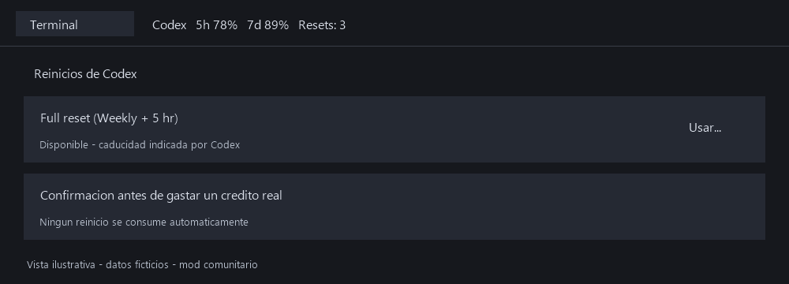

# Herdr Mods

Mods comunitarios para Herdr, compartidos entre macOS y Windows.
**No es un proyecto oficial de Herdr ni de OpenAI.**

## Paquetes

| Paquete | Función |
| --- | --- |
| [codex-usage](packages/codex-usage/) | Cuota restante de 5 horas y semanal, fechas de restablecimiento y canje de reinicios con confirmación. |



## Instalación

Requisitos: Herdr abierto y CLI `herdr-app` disponible; Node.js 20+ y Git.
Codex debe tener sesión de ChatGPT iniciada en **ese dispositivo**.
Se puede usar la CLI o el binario de la extensión de Codex de VS Code.
No hay dependencias npm que descargar.

```sh
git clone https://github.com/carlosYoko/herdr-mods.git
cd herdr-mods
npm test
npm run mods:list
npm run mod:install -- codex-usage
```

**Siempre eliges un único paquete por nombre.** `mods:list` solo lista los disponibles:
no instala ni ejecuta sus instaladores. Ejecutar `mod:install` sin nombre, con un
nombre desconocido o con `--all` no instala nada. No existe una instalación global
implícita. Al añadir futuros paquetes, solo se instalará el que indiques.

`codex-usage` agrupa `codex-quota` y `codex-resets` porque el indicador y el panel
colaboran. Se instala ese conjunto, no todos los mods del repositorio. El alias
anterior `npm run install:codex` sigue funcionando y elige solo `codex-usage`.

El instalador de `codex-usage` crea el layout personal `codex-usage`, clonado de `main`,
y clona la barra oficial como `codex-usage-tabs`.
Solo modifica esas copias y los mods del paquete; no edita archivos oficiales
ni sincroniza la sesión de Codex. Valida los tres mods antes de terminar.
El código de la barra se adapta a partir de la versión instalada localmente:
se conservan sus controles de Windows/macOS.

Si ya hay archivos con los nombres del paquete, la instalación se detiene.
Revísalos antes de permitir su reemplazo:

```sh
npm run mod:install -- codex-usage --update
```

Los archivos reemplazados se guardan en
`HERDR_APP_HOME/data/community-backups/<fecha>/`.
No hay rollback automático completo si una instalación falla a mitad;
los backups permiten restaurar los archivos anteriores manualmente.

Opciones: `--base-layout main`, `--home RUTA`, `--no-switch`.
También respeta `HERDR_APP_HOME`. El layout base debe usar una única barra
oficial `tabs`. Una estructura incompatible se rechaza antes de modificarla.
Una instalación administrada existente conserva su árbol de layout al actualizar.

Para volver al diseño original:
`herdr-app do layout.switch --name main`.
No borres los backups o clones hasta comprobar que todo funciona.

## Flujo de trabajo Mac ↔ Windows

Este repositorio es la **fuente de verdad**, no la carpeta de configuración de Herdr.

1. Antes de empezar en cada equipo: `git pull --ff-only`.
2. Edita el código de `packages/<paquete>/mods/<mod>/`.
3. Ejecuta `npm test` y `npm run mod:install -- codex-usage --update` (selecciona el paquete que has editado).
4. Prueba el mod en Herdr, incluidos menús y estados asíncronos.
5. Revisa `git diff`, haz commit y `git push`.
6. En el otro equipo: pull, tests e instalación de nuevo.

No trabajes sobre cambios sin publicar simultáneamente en ambos equipos.
Si Git rechaza un pull o push, resuelve el conflicto: no uses force-push.
El código instalado es una copia; editarlo directamente **no** actualiza el repo.
Si haces una prueba rápida en la configuración, traslada solo esos cambios
de código a la carpeta fuente antes del commit.

Nunca versiones toda `~/.config/herdr-app`, `~/.codex`, credenciales,
conversaciones, `shared.json`, preferencias personales o archivos regenerados.
La cuota usa la cuenta conectada en cada ordenador. No requiere trasladar
tokens ni iniciar sesión en GitHub dentro del mod.

## Organización

```
packages/
  codex-usage/
    herdr-package.json
    install.cjs
    RECIPE.md
    README.md
    preview.png
    preview.svg
    mods/
      codex-quota/
      codex-resets/
scripts/
  install.cjs
  test-installer.cjs
LICENSE
```

Un paquete puede agrupar varios mods que colaboran. Para uno nuevo, añade otra
carpeta en `packages/` con `herdr-package.json`, un `install.cjs` que exporte
`install(args)`, su receta y pruebas. El catálogo lo descubrirá sin cambiar
el dispatcher general ni añadir un script npm por paquete. El manifiesto debe
indicar `id` (igual al nombre de carpeta), `description`, `mods` e `installer`.
Su instalador debe validar opciones antes de escribir y mantener una lista
explícita de archivos propios. No copies toda la configuración al repo.

## Seguridad, compatibilidad y licencia

El paquete ejecuta Node y Codex, que hace peticiones a OpenAI usando su sesión.
El canje consume créditos reales, requiere selección y confirmación, y puede
no ser reversible. Lee [la documentación del paquete](packages/codex-usage/).

Probado en Windows con Herdr 0.1.15. El instalador y descubrimiento del binario
contemplan macOS, pero **todavía no están verificados en un Mac real**.
El protocolo de Codex app-server es experimental y puede cambiar.

Código propio bajo [MIT](LICENSE). Véase [THIRD_PARTY_NOTICES.md](THIRD_PARTY_NOTICES.md).
