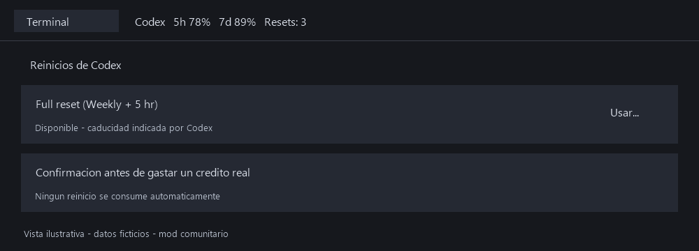

# Codex Usage

Un indicador pequeño integrado justo después de las pestañas de Herdr muestra el porcentaje de cuota de Codex que queda en las ventanas de 5 horas y semanal. Un botón ↻ abre los créditos de reinicio disponibles y permite canjear uno, siempre con confirmación explícita.

## What you see

- En la barra superior, después de las pestañas y dentro de su zona desplazable: `Codex 5h 78% 7d 89% ↻ 3`. Alto 26px, texto 11px, separación 8px. Los porcentajes son RESTANTES; los valores del ejemplo son ficticios.
- Colores del tema: muted para porcentajes, dim para nombre y contador, blocked para cuota restante ≤10%. Hover con theme.hover y esquinas 5px. No añade otra franja vertical.
- Tooltip: edad de la consulta, fecha/hora local de restablecimiento de ambas ventanas y contador.
- Diálogo de 550×540px, fondo popover, padding 18px, título 16px. Lista desplazable de tarjetas con título y descripción del servidor, estado, caducidad local y botón Usar…. Orden por vencimiento.
- Confirmación en el mismo diálogo, con título del crédito, advertencia de consumo real y botón Confirmar y usar 1 reinicio. Resultado o error en el panel.

## How it behaves

- Los estados working/blocked/done/idle de agentes no se usan para cuotas. La barra clonada conserva sus indicadores y navegación normales de Herdr.
- Clic en los porcentajes consulta la cuenta. Consulta automática cada 120 segundos. No usa animaciones ni timers de spinner.
- Sin campo de cuota: guion. Fecha de reset pasada: no presenta ese porcentaje como actual. Error: mantiene la última lectura atenuada y marca Codex !; el tooltip explica el error.
- Clic en ↻ abre el panel. Solo el botón de confirmación llama al canje. Cancelar no lo hace; abrir, instalar y actualizar tampoco.
- Créditos canjeables: status available, tipo codexRateLimits y no caducados. Estados desconocidos no se habilitan.
- Un intento guarda una clave de idempotencia y el ID del crédito en shared state antes de enviarse. Si el resultado es incierto, no permite escoger otro intento y ofrece reintentar el mismo. No reintenta automáticamente. Bloqueo compartido local de 45 segundos contra dobles pulsaciones.
- Codex puede devolver reset, nothingToReset, noCredit o alreadyRedeemed; se explica el resultado y se vuelve a leer la cuenta. El diálogo actualiza la barra mediante shared state.
- Cerrar/Escape no garantiza cancelar una petición ya enviada. No hay sincronización de intentos entre ordenadores.

## Built from

- Dos mods propios en mods/: codex-quota (indicador y helper Node) y codex-resets (diálogo).
- Un dispatcher descubre manifiestos herdr-package.json y exige seleccionar un único paquete. mods:list solo enumera; no hay instalación de todos ni selección implícita. El instalador propio de este paquete vive en packages/codex-usage/install.cjs y crea localmente codex-usage-tabs con mod.clone de tabs, añade una copia del helper UI y adapta tres anclajes del código. No distribuye código de la barra oficial ni sus assets. Conserva botones, iconos, navegación y lógica de macOS/Windows del clon local.
- Layout codex-usage: layout.clone desde main, sustituye el único content.mod tabs por codex-usage-tabs y añade preview layouts/codex-usage.svg. El resto del árbol queda igual.
- APIs de Herdr: exec, appHome, theme, openOverlay, props, closeOverlay, shared, setShared; View, div, h_flex y v_flex. init usa cx.spawn, cx.timer.every y cx.timer.after; render no hace consultas de red.
- Node lanza Codex app-server, manda initialize/initialized y account/rateLimits/read. En el panel pide detalles; en el fondo excludeResetCreditDetails=true. Canje: account/rateLimitResetCredit/consume con creditId e idempotencyKey. Timeout 20s y cierre del proceso.
- Codex gestiona autenticación y peticiones de red a OpenAI; no se abre auth.json directamente. El binario se encuentra en CODEX_BINARY, PATH o extensión openai.chatgpt de VS Code. No se leen conversaciones ni se inicia un turno de modelo.
- Arte: preview ilustrativo propio, sin captura de una cuenta real. Sin fonts ni dependencias redistribuidas.

## Watch out

- Requiere Node 20+, Git, Herdr abierto, CLI herdr-app y sesión ChatGPT en Codex del equipo destino. La cuenta no viaja por Git.
- App-server es experimental. Los anclajes de tabs están verificados con Herdr 0.1.15; una barra con estructura diferente debe rechazarse, no parchearse a ciegas.
- Windows probado; macOS contemplado pero aún sin validación real. Mantener los controles originales de ventanas, traffic lights y padding del clon.
- El instalador no sobrescribe por defecto. --update permite reemplazo con backups locales; no restaura automáticamente todos los pasos de una instalación fallida. No tocar .state de layouts.
- Nunca versionar shared state, credenciales, preferencias o capturas de espacios personales. Solo archivos fuente expresamente listados.
- El contador es el número de créditos informado por el servidor, no un supuesto número de reinicios semanales que se regenere cada semana.
- El backend puede limitar los detalles devueltos: contar availableCount, no inferir el total a partir del tamaño de la lista.
- Si un canje queda incierto, conservar su clave; no crear otra al reabrir. No probar un canje real sin confirmación de la persona.

## Done when

1. npm test pasa sin red ni consumo de créditos reales.
2. El instalador rechaza anclajes incompatibles, nombres ajenos y reemplazos sin --update. El dispatcher no instala nada al listar, omitir nombre o seleccionar nombres desconocidos/varios/--all; las pruebas simulan dos paquetes y verifican que solo se invoca el seleccionado.
3. herdr-app check pasa para los dos mods y la barra clonada.
4. En la app el indicador aparece junto a las pestañas sin añadir altura a la barra; navegación y botones originales funcionan.
5. La consulta autenticada muestra las ventanas reales disponibles o explica su ausencia/error; nunca muestra como actual un registro histórico.
6. Abrir ↻ lista los detalles reales y caducidades sin gastar créditos.
7. La selección ofrece una segunda confirmación; los cuatro resultados y la clave de idempotencia se verifican con un servidor simulado.
8. Volver a main deja disponible el layout original. El repo no contiene código oficial clonado, credenciales ni estado del dispositivo.
