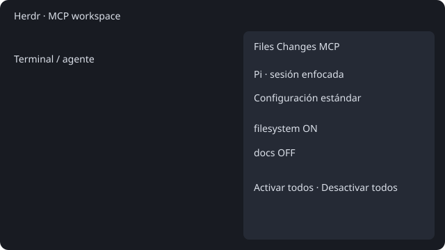

# MCP Manager

Panel **MCP** junto a Files y Changes, recordado por espacio. Sigue la terminal enfocada, muestra definiciones MCP estándar, su origen y su estado configurado, y permite activar/desactivar individualmente o en bloque con confirmación.



## Instalar

Desde la raíz del repositorio, con Herdr abierto y Node.js 20+ en su PATH:

```sh
npm ci
npm test
npm run mod:install -- mcp-manager
# O conserva la integración de cuotas de un layout ya instalado:
npm run mod:install -- mcp-manager --base-layout codex-usage
```

Crea `mcp-workspace`, `mcp-workspace-tabs` y `mcp-manager`. Clona localmente el layout base y su barra con `herdr-app`; no distribuye código oficial. El layout original queda intacto. Actualizar solo este paquete:

```sh
npm run mod:install -- mcp-manager --update
```

La actualización conserva el layout y la barra clonados: no vuelve a copiar futuras mejoras del layout base. Si actualizas cuotas después, las copias de cuota de `mcp-workspace-tabs` no se actualizan automáticamente.

Opciones: `--base-layout <nombre>` (primera instalación), `--home <ruta>`, `--update`, `--no-switch`. Instalación sin rollback completo; backups de archivos previos en `data/community-backups/mcp-*`. No reemplaza destinos ajenos. `Ctrl+Shift+L` permite volver al layout anterior.

## Compatibilidad y alcance real

| Cliente | Archivos estándar | Acciones |
| --- | --- | --- |
| Pi con MCP integrado | `~/.pi/agent/mcp.json`, `<cwd>/.pi/mcp.json` | Leer, activar/desactivar cada uno o todos. Proyecto sustituye usuario; overrides parciales heredan la definición de usuario. |
| Codex | `~/.codex/config.toml`, `.codex/config.toml` desde raíz del repositorio hasta cwd; sin repo, desde raíz del filesystem | Leer y modificar `mcp_servers.<nombre>.enabled` en el archivo que define la entrada visible. |
| Claude Code | `~/.claude.json` (tabla global), `<cwd>/.mcp.json` | Solo lectura de definiciones; no se interpretan preferencias de permisos/desactivación ni entradas locales por proyecto de `.claude.json`. |
| Remotos, otros agentes, Claude Desktop, chat integrado de VS Code | — | Sin acceso ni edición. |

**No es un inspector de la conexión activa de la sesión.** Herdr expone el agente reportado y cwd, pero no garantiza acceso a sus opciones de arranque, entorno, perfil o estado interno. Por ello el panel muestra **configuración estándar**, nunca afirma que el servidor esté conectado. No conoce `CODEX_HOME`, `PI_CODING_AGENT_DIR`, flags `--config`, `--no-mcp`, extensiones, adaptadores o perfiles personalizados de esa sesión. Las tablas MCP de perfiles Codex en la configuración de usuario fuerzan solo lectura. Un agente no compatible no reutiliza los MCP de otra pestaña.

Solo los proyectos de confianza son cargados por Pi/Codex; el panel no concede confianza ni conoce su decisión. No agrega servidores, no gestiona OAuth ni instala MCP. Si no hay definiciones estándar, muestra una lista vacía, no significa que una extensión no tenga MCP. Cliente detectado por el reporte OSC del terminal, no por una sesión de chat externa.

## Uso y seguridad

1. Enfoca una terminal de Pi o Codex y abre **MCP**.
2. Revisa origen **Usuario/Proyecto** y ruta de cada fila. “Ver alcance y límites” muestra los archivos buscados, incluso ausentes.
3. Pulsa ON/OFF o una acción para todos. La selección **no escribe**.
4. Confirma los nombres y el alcance. Un archivo de usuario afecta a otras sesiones; uno de proyecto puede estar versionado/compartido.
5. Recarga Pi con `/reload` o reinicia Codex manualmente. No se envía texto ni se reinician terminales automáticamente.

Al guardar se conservan campos desconocidos, comandos y secretos como datos; **JSON/TOML se reformatean y TOML pierde comentarios**. Se modifica el archivo que aporta cada entrada efectiva, no se crea un override local para aislar automáticamente a esta sesión.

El helper compara una huella de todos los archivos con la lectura confirmada, bloquea destinos entre sus propias operaciones, valida de nuevo y crea backups `archivo.herdr-backup-<uuid>` junto a cada original. Escribe un temporal y lo renombra por archivo. No hay transacción global entre varios archivos ni garantía frente a un editor externo que escriba exactamente durante el rename. Si falla a mitad, puede haber cambios parciales: actualizar y revisar los backups, sin reintentos automáticos. Tras un cierre forzado puede quedar `archivo.herdr-mcp.lock`; eliminarlo manualmente solo tras comprobar que no hay una escritura activa. Archivos de configuración que son symlinks se rechazan.

**Los backups contienen los mismos secretos que el original.** Se crean con modo 0600 en Unix; Windows hereda ACL de la carpeta. No los publiques. Un backup se restaura manualmente, con el agente detenido y tras revisar cambios posteriores.

El mod ejecuta **Node.js local** mediante `exec`, lee los archivos anteriores fuera de su carpeta y, solo tras confirmar, los modifica y crea backups. No realiza solicitudes de red, no conecta con servidores MCP, no evalúa valores `!comando`, no ejecuta comandos de configuraciones y no muestra URLs, variables de entorno, tokens ni contenido de credenciales. El proceso helper hereda el entorno de Herdr, no el de la terminal. Lee a demanda, al cambiar contexto y cada 15 segundos solo mientras se muestra este panel.

## Validación

`npm test` usa fixtures temporales: precedencia Pi, cambios en bloque, backups, huellas obsoletas, locks, nombres TOML con puntos, conservación de campos/secretos, solo lectura y flujo UI de confirmación/cancelación. No cambia configuraciones reales ni arranca servidores. El instalador ejecuta `herdr-app check` para ambos mods. Interfaz probada en Windows/Herdr 0.1.15; macOS y Linux pendientes de validación visual real. Las pruebas mock de UI no sustituyen la interacción nativa con filas reales.

Para quitarlo, cambia de layout y elimina únicamente `layouts/mcp-workspace.json`, `layouts/mcp-workspace.svg`, `mods/mcp-manager/` y `mods/mcp-workspace-tabs/` (y su marcador `data/community-mcp-manager-install.json`). Esto **no revierte cambios en las configuraciones MCP**.
