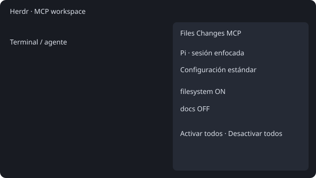

# MCP Manager

Un botón MCP a la derecha de Files y Changes abre el panel de configuración MCP del agente enfocado. Usa el mismo marco lateral y la misma memoria por espacio de la barra original, sin sustituir cuotas u otros controles del layout base.

## What you see

- Barra de pestañas existente con un botón MCP de 26 px de alto y un icono monocromo de 14 px. Fondo seleccionado cuando abre el panel.
- Panel lateral del layout base, inicialmente 368 px (mínimo 280), borde de 1 px, radio 10 y fondo `theme().chrome`.
- Cabecera de 40 px: MCP, Actualizar y ×. Contenido con padding 12 y separación 12; texto 13 px, notas y botones 12 px, colores del tema.
- Cliente y dirección de terminal, cwd, etiqueta de configuración estándar, botón de detalles y aviso de recarga. En detalles: límites y rutas buscadas, incluidas las ausentes.
- Activar todos / Desactivar todos y filas de servidores, con nombre, ON/OFF, origen y ruta. Claude Code muestra Definido y no permite editar.
- La confirmación aparece dentro del panel, borde `blocked`, con nombres, advertencia de alcance, backups y pérdida de comentarios TOML; Confirmar cambio y Cancelar.

## How it behaves

MCP abre/cierra el panel, igual que Files/Changes; elegir uno sustituye al anterior. El estado del panel se recuerda por espacio mediante la barra clonada. Actualizar relee y cancela una selección no confirmada. × lo oculta.

Sigue el terminal realmente enfocado (incluido `terminal.show`); no el primer agente de otra pestaña. Cambiar dirección, cliente o cwd borra datos y confirmación anteriores. Working, blocked, done e idle no cambian la representación de MCP: no indican conexión de servidores ni deben interpretarse como tal. Terminal sin reporte compatible muestra el motivo y no modifica nada; remoto muestra que no está admitido.

Seleccionar un cambio prepara la confirmación; solo Confirmar ejecuta escritura. Los controles se deshabilitan mientras se lee/escribe o se confirma otro cambio. Hay mensajes de lectura, guardado, error y éxito. No se reinicia ni envía nada a la terminal. Pi necesita /reload; Codex, reinicio. Poll de datos cada 15 segundos solo cuando MCP es el panel visible. Sin animaciones mediante timers. Español automático si el idioma del sistema es español, inglés para el resto, como codex-usage. Se traducen también avisos, confirmaciones, orígenes y errores; nombres técnicos y rutas no cambian. No se descarta una confirmación pendiente por cambiar el idioma.

## Built from

Instalador independiente con manifiesto `mcp-manager`. Clona localmente el layout elegido como `mcp-workspace` y su mod de tabs como `mcp-workspace-tabs`; añade `{id:'mcp', type:'block', content:{mod:'mcp-manager'}}` a `panel-body`. Parchea dos anclas pequeñas en la barra: habilitar MCP en la lista y añadir su botón. No redistribuye código oficial. Preview SVG sintética y propio icono SVG.

El panel usa View/div, h_flex/v_flex, focused, panes, agents, terminals, spaces, layout, theme, appHome, exec y run. Sin props especiales. Invoca Node con `mods/mcp-manager/manage.cjs` y una petición JSON de argumentos estructurados. El helper usa fs, path, os, crypto y smol-toml fijado por lockfile. `i18n.js` contiene diccionarios en/es, traductor con fallback inglés y errores por código. `locale.cjs` detecta el idioma mediante Get-UICulture en Windows, AppleLanguages en macOS o variables de locale en Linux; fallback Intl/inglés. El panel consulta la acción `language` del helper al iniciar y comparte `mcp.ui.language`, independientemente de cuotas. No usa shell ni conecta con MCP. El instalador copia solo los archivos propios y smol-toml con licencia.

Adaptadores: Pi (JSON usuario/proyecto, precedencia y overrides parciales), Codex (TOML usuario/capas de proyecto y campo enabled), Claude Code (tablas de definiciones JSON, solo lectura). No expone comandos/URLs/secretos: devuelve nombres, booleanos, rutas y huella. Apply exige confirmación y huella vigente, locks exclusivos, backup de cada original, temporales y rename por archivo.

## Watch out

No conoce flags/perfiles/entorno ni conexiones de la terminal; la etiqueta debe decir configuración estándar. No confundir entradas con conexiones activas. No detecta MCP registrados por extensiones ni otros chats en VS Code. CWD no siempre es el directorio original de arranque. Confianza del proyecto desconocida. Claude no incluye entradas locales por proyecto ni permisos. Perfiles Codex con tablas MCP en archivo de usuario fuerzan solo lectura. No crear overrides adivinando semánticas de cliente.

JSON y TOML se reformatean; TOML pierde comentarios. Backups contienen secretos. No hay transacción global, rollback ni reintento automáticos. Locks huérfanos requieren revisión manual. No afirmar aislamiento de sesión al modificar configuración global. Rechazar archivos inválidos y symlinks antes de escribir. Máximo 1 MiB por archivo. Sin instalación/alta/borrado de MCP ni autenticación. Las actualizaciones del layout base no se propagan al clon.

No guardar un cx entre callbacks. Manejar cambios de foco durante una lectura/escritura para no publicar resultados antiguos. Herdr check no ejecuta filas ni estados asíncronos: probar esos caminos con mocks y revisar la app. Windows validado visualmente; otros sistemas no.

## Done when

- npm test pasa, incluyendo fixtures MCP y UI en español e inglés sin tocar configuraciones reales; claves y placeholders coinciden y un idioma no soportado cae a inglés.
- herdr-app check pasa para mcp-manager y mcp-workspace-tabs.
- En la app se ve MCP junto a Files/Changes y se conserva la barra de cuotas del layout base elegido.
- Pi sin configuración muestra lista vacía; una shell no reutiliza datos Pi.
- Los fixtures Pi respetan override parcial y los TOML conservan los valores de comandos/env al alternar enabled.
- Antes de confirmar no se escribe; Cancelar no escribe; snapshot obsoleto y lock ocupado fallan sin reemplazar el original.
- Claude es solo lectura, errores de parser no exponen extractos de configuración y backups contienen el original.
